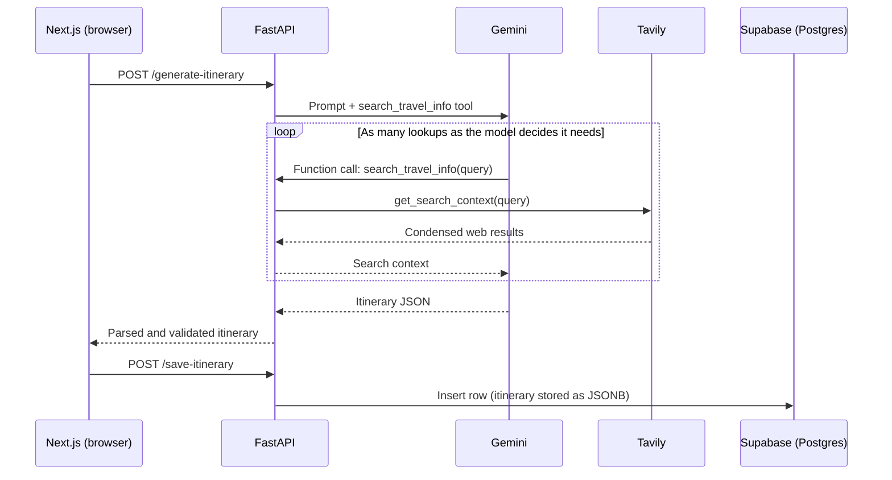

# WanderMind

**AI travel itinerary planner with live web grounding**

WanderMind takes a destination, travel dates, and a list of interests and returns a day-by-day itinerary. Before it writes the plan, the model can search the live web through Tavily to check things that go stale quickly, like opening hours, whether a venue is still operating, and events happening on your dates. Signed-in users can save trips, edit them later, and delete them.

Built with Next.js, FastAPI, Google Gemini, Tavily, and Supabase.

---

## Why I built this

LLMs are good at structure and bad at freshness. A model can write a convincing plan around a museum that closed last year or a festival that moved to a different month. I wanted to build a customer-facing AI app end to end and deal with that problem directly: API design, LLM orchestration, tool calling, output handling, auth, and persistence.

It is also the kind of solution I would scope, build, and demo in a Solutions Engineering or Forward Deployed Engineering role.

---

## Features

- Generate a multi-day itinerary from destination, date range, and interests
- Live web lookups during generation (Tavily) for opening hours, venue status, and local events
- Email auth with Supabase
- Save itineraries to your account
- View past trips, edit activities, and delete trips
- User profile page (home country, preferred currency, travel preferences)

---

## How it works



### The agentic tool layer (Tavily)

The backend exposes one tool to Gemini, `search_travel_info(query)`, which wraps Tavily's `get_search_context`. It is passed to the Google GenAI SDK as a plain Python function, so the SDK builds the function declaration from the signature and docstring and runs the call loop automatically. The model decides when to search and what to search for. The prompt tells it to verify opening hours, venue status, and events for the specific travel dates.

A few decisions worth calling out:

- **The model chooses the queries.** There is no hardcoded list of lookups. A food trip to Tokyo and a hiking trip to Banff lead to very different searches.
- **Search failures degrade instead of crashing.** If Tavily errors out, the tool returns the error message to the model as text, and generation continues with the model's own knowledge.
- **`get_search_context` instead of raw search results.** It returns compact, LLM-ready context, which keeps token usage down across multiple tool calls.
- **Tool calling and strict JSON mode don't mix here**, so the prompt asks for a single JSON object and the backend extracts it from the response text (stripping any markdown fences), parses it, and checks the shape before returning it.

### Architecture notes

- **Separate frontend and backend.** Next.js runs on port 3000 and FastAPI on port 8000. The Gemini, Tavily, and Supabase service role keys live only on the backend and never reach the browser.
- **Response validation.** The generate endpoint declares a Pydantic `response_model`, so FastAPI validates the itinerary shape (day number plus a list of activities) before sending it to the client.
- **JSONB storage.** Each trip's multi-day plan is stored in a single `itinerary_data` JSONB column, which fits the nested day and activity structure without extra join tables.
- **Row Level Security.** RLS policies on `profiles` and `itineraries` limit authenticated users to their own rows when the frontend talks to Supabase directly (for example, the profile page).
- **Database triggers.** A trigger creates a profile row when a user signs up, and another keeps `modified_at` current on profile edits.
- **Logging.** The backend writes request, generation, and database events to `backend/logs/app.log`.

---

## Tech stack

| Layer | Tools |
|---|---|
| Frontend | Next.js (Pages Router), React, Tailwind CSS v4, react-date-range |
| Auth and data client | `@supabase/ssr`, `@supabase/supabase-js`, `@supabase/auth-ui-react` |
| Backend | Python, FastAPI, Pydantic, Uvicorn |
| LLM | Google Gemini via the `google-genai` SDK, with automatic function calling |
| Live web search | Tavily (`tavily-python`) |
| Database | Supabase Postgres with JSONB, RLS policies, and PL/pgSQL triggers |

---

## API endpoints

| Method | Path | Purpose |
|---|---|---|
| POST | `/generate-itinerary` | Generate an itinerary (with live web lookups) |
| POST | `/save-itinerary` | Save a generated itinerary for a user |
| GET | `/get-trips/{user_id}` | List a user's saved trips, newest first |
| PUT | `/update-itinerary/{trip_id}` | Update the activities in a saved trip |
| DELETE | `/delete-itinerary/{trip_id}/{user_id}` | Delete a saved trip |

With the backend running, interactive docs are at `http://localhost:8000/docs`.

---

## Local setup

### Prerequisites

- Node.js 18+
- Python 3.10+
- A free [Supabase](https://supabase.com) project
- A [Google AI Studio](https://aistudio.google.com) API key
- A [Tavily](https://tavily.com) API key (the free tier is enough for development)

### 1. Database

Run the SQL script in [setup.md](./setup.md) in the Supabase SQL Editor. It creates the tables, RLS policies, and triggers.

### 2. Environment variables

Create `backend/.env`:

```env
GEMINI_API_KEY=your_gemini_api_key
TAVILY_API_KEY=your_tavily_api_key
SUPABASE_URL=your_supabase_url
SUPABASE_SERVICE_ROLE_KEY=your_supabase_service_role_key
```

Create `frontend/.env.local`:

```env
NEXT_PUBLIC_SUPABASE_URL=your_supabase_url
NEXT_PUBLIC_SUPABASE_ANON_KEY=your_supabase_anon_key
```

The backend will not start without the Gemini and Supabase variables, and the Tavily client needs its key at startup too. Both env files are gitignored.

### 3. Backend

```bash
cd backend
python -m venv venv
source venv/bin/activate      # Windows: venv\Scripts\activate
pip install -r requirements.txt
uvicorn main:app --reload
```

### 4. Frontend

```bash
cd frontend
npm install
npm run dev
```

Open `http://localhost:3000`.

---

## Known limitations and roadmap

I would rather list these than have someone find them:

- **Backend auth.** The backend uses the Supabase service role key, which bypasses RLS, and trusts the `user_id` sent by the client. The next step is to send the user's Supabase access token with each request, verify it in FastAPI, and take the user ID from the verified token.
- **CORS** currently allows all origins. It should be locked to the frontend's URL before any deployment.
- **Source visibility.** Search results inform the itinerary but are not shown to the user. Returning source links per activity would make the output easier to trust and check.
- **Tool use is not guaranteed.** The model decides whether to search, so a trip can be generated with zero lookups. Logging tool calls per request would make this measurable.
- **Blocking calls.** Endpoints are synchronous, so a long generation with several searches holds a worker. Moving to async clients would help under load.
- **Hardcoded API URL.** The frontend calls `http://localhost:8000` directly. This should come from an environment variable.

---

## Author

**Anjitha Balachandran**
[LinkedIn](https://www.linkedin.com/in/anjitha-balachandran-673b62146/) · [Email](mailto:2011anjitha@gmail.com)
