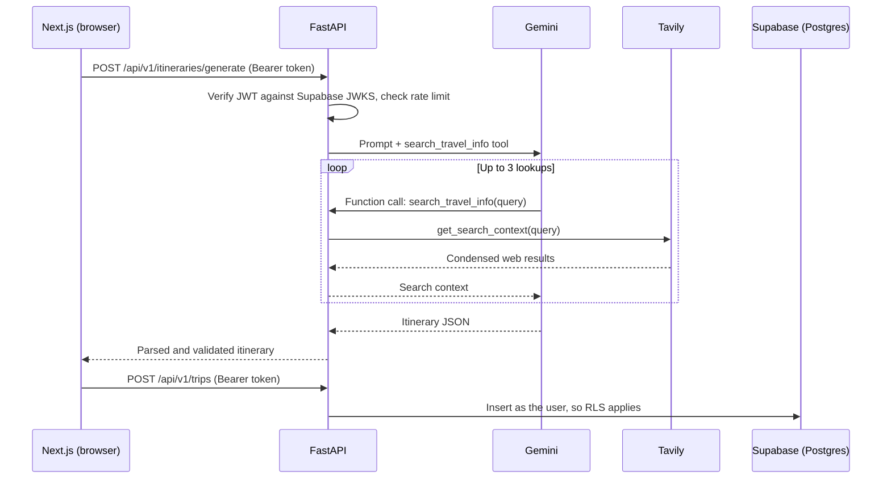

# WanderMind

**AI travel itinerary planner with live web grounding**

WanderMind takes a destination, travel dates, and a list of interests and returns a day-by-day itinerary. Before it writes the plan, the model can search the live web through Tavily to check things that go stale quickly, like opening hours, whether a venue is still operating, and events happening on your dates. Signed-in users can save trips, edit them later, and delete them.

Built with Next.js, FastAPI, Google Gemini, Tavily, and Supabase.

---

## Why I built this

LLMs are good at structure and bad at freshness. A model can write a convincing plan around a museum that closed last year or a festival that moved to a different month. I wanted to build a customer-facing AI app end to end and deal with that problem directly: API design, LLM orchestration, tool calling, output handling, auth, and persistence.

It is also the kind of solution I would scope, build, and demo in a Solutions Engineering or Forward Deployed Engineering role.

---

## Features

- Generate a multi-day itinerary from destination, date range, and interests
- Live web lookups during generation (Tavily) for opening hours, venue status, and local events
- Email auth with Supabase
- Save itineraries to your account
- View past trips, edit activities, and delete trips
- User profile page (home country, preferred currency, travel preferences)

---

## How it works



### Authentication

1. The browser signs in with Supabase and receives an access token. Every API call sends it as `Authorization: Bearer <token>`, through `frontend/utils/api.js`.
2. FastAPI verifies the token locally. Supabase signs tokens for this project with ES256, so the backend checks the signature against the public key from the JWKS endpoint (cached) and validates `exp`, `aud`, and `iss`. The accepted algorithm is fixed in code.
3. The user ID comes only from the token's `sub` claim. The browser never sends a `user_id`, and a request body containing one is rejected with a 422.
4. For each request the backend creates a Supabase client with the anon key and the user's token, so Postgres runs the query as that user and Row Level Security applies. The service role key is not used by the application.

Queries also filter on `user_id`, as a second layer on top of RLS. An unknown trip and someone else's trip both return 404.

`/home`, `/trips`, and `/profile` share a client-side session check, `useRequireAuth`. It controls what the UI shows. The protection for data is the API and RLS.

### The agentic tool layer (Tavily)

The backend exposes one tool to Gemini, `search_travel_info(query)`, which wraps Tavily's `get_search_context`. It is passed to the Google GenAI SDK as a plain Python function, so the SDK builds the function declaration from the signature and docstring and runs the call loop automatically, up to 3 calls per request. The model decides when to search and what to search for. If it reaches the cap while still asking to search, the backend makes one more Gemini call with tools off, so the itinerary is written from the results so far. The prompt tells it to verify opening hours, venue status, and events for the specific travel dates.

A few decisions worth calling out:

- **The model chooses the queries.** There is no hardcoded list of lookups. A food trip to Tokyo and a hiking trip to Banff lead to very different searches.
- **Search failures degrade instead of crashing.** If Tavily errors out, the tool returns a generic message to the model, the details go to the server logs, and generation continues with the model's own knowledge.
- **`get_search_context` instead of raw search results.** It returns compact, LLM-ready context, which keeps token usage down across multiple tool calls.
- **Tool calling and strict JSON mode don't mix here**, so the prompt asks for a single JSON object and the backend extracts it from the response text (stripping any markdown fences), parses it, and validates it with Pydantic before returning it.
- **User input and search results are treated as data.** Trip details go in a delimited block of the prompt, and the system instruction tells the model not to follow instructions found there or in tool results. This reduces prompt injection risk but cannot rule it out.

### Architecture notes

- **Separate frontend and backend.** Next.js runs on port 3000 and FastAPI on port 8000. The Gemini and Tavily keys live only on the backend. The browser holds only the Supabase anon key, which is safe to expose when RLS is on.
- **Validation.** Pydantic validates requests and model output, including limits on days, activities, and text lengths, and a 14-day trip cap on generate and save. Unknown fields are rejected.
- **Database constraints.** CHECK constraints cap itinerary and profile sizes in Postgres, so the limits on size also apply to writes that skip FastAPI and go straight to PostgREST.
- **Rate limits.** Generation is limited per user, 5 per minute and 30 per day by default.
- **JSONB storage.** Each trip's multi-day plan is stored in a single `itinerary_data` JSONB column, which fits the nested day and activity structure without extra join tables.
- **Row Level Security.** RLS policies on `profiles` and `itineraries` limit authenticated users to their own rows, for requests through FastAPI and for the profile page, which talks to Supabase directly.
- **Database triggers.** A trigger creates a profile row when a user signs up, and another keeps `modified_at` current on profile edits.
- **Errors.** Clients get a generic message and a request ID. Details stay in the server logs under that ID.
- **Logging.** The backend writes structured JSON to stdout, with hashed user IDs and no destinations, interests, or activities.

---

## Tech stack

| Layer | Tools |
|---|---|
| Frontend | Next.js (Pages Router), React, Tailwind CSS v4, react-date-range |
| Auth and data client | `@supabase/ssr`, `@supabase/supabase-js`, `@supabase/auth-ui-react` |
| Backend | Python, FastAPI, Pydantic, Uvicorn, PyJWT, slowapi |
| LLM | Google Gemini via the `google-genai` SDK, with automatic function calling |
| Live web search | Tavily (`tavily-python`) |
| Database | Supabase Postgres with JSONB, RLS policies, and PL/pgSQL triggers |

---

## API endpoints

| Method | Path | Purpose |
|---|---|---|
| POST | `/api/v1/itineraries/generate` | Generate an itinerary (with live web lookups) |
| GET | `/api/v1/trips` | List your saved trips, newest first |
| POST | `/api/v1/trips` | Save a generated itinerary |
| PATCH | `/api/v1/trips/{trip_id}` | Update the activities in a saved trip |
| DELETE | `/api/v1/trips/{trip_id}` | Delete a saved trip |

Every endpoint needs an `Authorization: Bearer <access_token>` header. With the backend running, interactive docs are at `http://localhost:8000/docs`.

---

## Local setup

### Prerequisites

- Node.js 18+
- Python 3.10+
- A free [Supabase](https://supabase.com) project
- A [Google AI Studio](https://aistudio.google.com) API key
- A [Tavily](https://tavily.com) API key (the free tier is enough for development)

### 1. Database

Apply the migrations in `supabase/migrations/` with the Supabase CLI. See [setup.md](./setup.md).

### 2. Environment variables

```bash
cp backend/.env.example backend/.env
cp frontend/.env.example frontend/.env.local
```

Fill in both files. The backend will not start without `GEMINI_API_KEY`, `TAVILY_API_KEY`, `SUPABASE_URL`, and `SUPABASE_ANON_KEY`. `ALLOWED_ORIGINS` is a comma-separated list of frontend origins. Both env files are gitignored.

### 3. Backend

```bash
cd backend
python -m venv venv
source venv/bin/activate      # Windows: venv\Scripts\activate
pip install -r requirements.txt
uvicorn main:app --reload
```

### 4. Frontend

```bash
cd frontend
npm install
npm run dev
```

Open `http://localhost:3000`.

---

## Tests

### Unit tests

```bash
cd backend
pytest
```

These need no network, Docker, or real credentials. Sockets are disabled during the run, and tokens are signed with a test key and checked by the real verifier.

### Integration tests

These run against a local Supabase stack and need Docker. They sign up two real users, then prove RLS blocks cross-user access using raw PostgREST calls with no `user_id` filter, and that CHECK constraints reject oversized data written directly with a user token. One suite runs the whole chain through FastAPI.

From the repo root:

```bash
npx supabase start
npx supabase db reset
export SUPABASE_TEST_ANON_KEY=$(npx supabase status -o env | grep '^ANON_KEY=' | cut -d= -f2- | tr -d '"')
cd backend
pytest -m integration
```

They are skipped by a plain `pytest`.

---

## Known limitations and roadmap

I would rather list these than have someone find them:

- **Rate limits are per process.** Counters live in memory, so they reset on restart and multiply with each worker. A shared store is needed before scaling out.
- **Tokens stay valid until they expire.** Tokens are verified locally, so signing out does not revoke one that has already been issued.
- **Field-level limits only apply through FastAPI.** Users can write to their own rows directly through PostgREST with the anon key. RLS keeps them out of other users' data and CHECK constraints cap total size, but per-activity limits are only enforced by the API.
- **Older trips can exceed the limits.** Trips saved before validation existed still load, but editing one that breaks a limit returns a 422 until it is trimmed.
- **Source visibility.** Search results inform the itinerary but are not shown to the user. Returning source links per activity would make the output easier to trust and check.
- **Tool use is not guaranteed.** The model decides whether to search, so a trip can be generated with zero lookups. Logging tool calls per request would make this measurable.
- **Blocking calls.** Endpoints are synchronous, so a long generation with several searches holds a worker. Moving to async clients would help under load.

---

## Author

**Anjitha Balachandran**
[LinkedIn](https://www.linkedin.com/in/anjitha-balachandran-673b62146/) · [Email](mailto:2011anjitha@gmail.com)
